 

 

 

<h3>things I build</h3>

<table>
<tr>
<td width="50%" valign="top">

**[AHDGame](https://github.com/HyawiiGithub/AHDGame)** — browser multiplayer political + economic simulation. Elections, legislation, corporations, central banks, hourly turns.

**[crown](https://github.com/HyawiiGithub/crown)** — TypeScript, no description needed, just vibes.

</td>
<td width="50%" valign="top">

**[discord-economic-intelligence](https://github.com/HyawiiGithub/discord-economic-intelligence)** — per-server Discord economy with markets, an AI Jarvis and a full Cloudflare dashboard.

**[dmWipe](https://github.com/HyawiiGithub/dmWipe)** — Vencord plugin that bulk-deletes messages in DMs, groups and servers.

</td>
</tr>
<tr>
<td width="50%" valign="top">

**[vanguard-group](https://github.com/HyawiiGithub/vanguard-group)** — corporate coordination alliance: floor prices, 10–15% margins, no mercy.

**[Modern-Day-Victoria-3-Web](https://github.com/HyawiiGithub/Modern-Day-Victoria-3-Web)** — grand strategy, but in a browser tab.

</td>
<td width="50%" valign="top">

**[swiss-constitution](https://github.com/HyawiiGithub/swiss-constitution)** — a mock government that actually has its paperwork in order.

**[Flint-And-Steel-MP](https://github.com/HyawiiGithub/Flint-And-Steel-MP)** — Python multiplayer, questionable descriptions, good time.

</td>
</tr>
</table>

<h3>toolbox</h3>

 

every card above is drawn from scratch in [`scripts/generate.py`](scripts/generate.py) — no third-party image services —
and redrawn every day by [a GitHub Action](.github/workflows/refresh-cards.yml)

