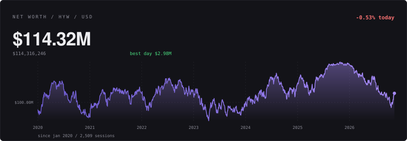
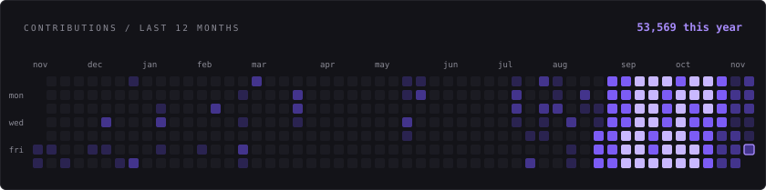

### hyawii

i just code anything. belgium.

mostly typescript and python, mostly things that have no business running in a browser tab.
right now that means multiplayer political/economic sims: hourly turns, elections, central banks,
corporations quietly undercutting each other while nobody's watching the market page.

<a href="https://hyawiigithub.github.io/HyawiiGithub/"></a>

<a href="https://hyawiigithub.github.io/HyawiiGithub/"></a>

<a href="https://hyawiigithub.github.io/HyawiiGithub/#game"></a>

one commit moves the number. hover a square on [the live page](https://hyawiigithub.github.io/HyawiiGithub/) for the exact count, the charts above are links too.

<!-- stats:start -->
```text
53,566 contributions  |  128 active days  |  81 day streak (best 81)
last 30 days  9,222  |  busiest day  1,397 (sep 27)

html 43%   javascript 28%   typescript 26%   css 3%   python 1%
```
<!-- stats:end -->

---

**what i'm actually building**

- **[AHDGame](https://github.com/HyawiiGithub/AHDGame)**. browser multiplayer political + economic sim. elections, legislation, corporations, central banks, hourly turns.
- **[discord-economic-intelligence](https://github.com/HyawiiGithub/discord-economic-intelligence)**. per-server discord economy: markets, a jarvis, and a cloudflare dashboard doing more than it should.
- **[dmWipe](https://github.com/HyawiiGithub/dmWipe)**. vencord plugin. bulk deletes messages. you know why.
- **[vanguard-group](https://github.com/HyawiiGithub/vanguard-group)**. corporate alliance inside AHD. floor prices, 10 to 15% margins, no charity.

**and then the rest**

- **[crown](https://github.com/HyawiiGithub/crown)**. typescript. it's called crown. that's all i'm giving you.
- **[swiss-constitution](https://github.com/HyawiiGithub/swiss-constitution)**, **[CEC-Elections](https://github.com/HyawiiGithub/CEC-Elections)**, **[USSR-stock](https://github.com/HyawiiGithub/USSR-stock)**. mock governments. occasionally run better than the real ones.
- **victoria 3 mods**: [A New Century](https://github.com/HyawiiGithub/A-New-Century), [Modern-Day-Victoria-3-Web](https://github.com/HyawiiGithub/Modern-Day-Victoria-3-Web). yes, the map is still cursed.
- **[Flint-And-Steel-MP](https://github.com/HyawiiGithub/Flint-And-Steel-MP)**, **[Twitter-MD-RP](https://github.com/HyawiiGithub/Twitter-MD-RP)**. older stuff, still running somewhere.

---

[nohello.net](https://nohello.net) · loud in issues, slow in dms

<sub>graph and numbers come from a python script in this repo, rebuilt daily. the hoverable version and the game live on [github pages](https://hyawiigithub.github.io/HyawiiGithub/).</sub>
